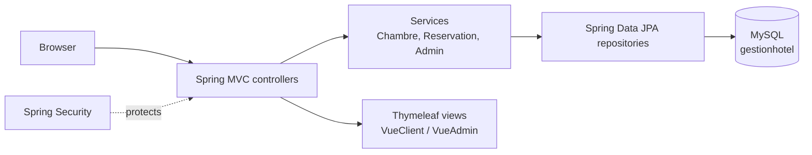

<div align="center">

# 🏨 Hotel Management System

**A Spring Boot web application to manage hotel rooms and reservations, with a public showcase site and a secured admin area.**


</div>

---

## Overview

Two interfaces on one Spring Boot application:

| Interface | Pages | Access |
|---|---|---|
| **Client site** | Home, About, Services, Rooms, Team, Testimonials, Contact, Booking | Public |
| **Admin area** | Login, dashboard, room management, reservation management, availability check | Spring Security login |

## Features

- **Rooms**: create, update, delete, manage availability
- **Reservations**: booking form with check-in / check-out dates, admin list and edit forms, availability check
- **Admin dashboard** with an overview of hotel activity
- **Authentication** for administrators with Spring Security
- **Logging** configured with Logback (log files are git-ignored)

## Architecture



Source layout: `Controller → Service → Repository → Entity (Chambre, Reservation, Admin)`, configuration in `Config/SecurityConfig.java`.

## Tech stack

Java 21 · Spring Boot 3.3 (Web, Data JPA, Security, Thymeleaf) · MySQL · Bootstrap · Maven

## Getting started

**Prerequisites:** JDK 21, MySQL 8, Maven (or the bundled `mvnw`).

```bash
git clone https://github.com/atef-hadef/gestion_hotel.git
cd gestion_hotel

# 1. Create the database
mysql -u root -p -e "CREATE DATABASE gestionhotel CHARACTER SET utf8mb4;"

# 2. Check src/main/resources/application.properties
#    (datasource URL / username / password for your MySQL)

# 3. Run
./mvnw spring-boot:run          # Windows: mvnw.cmd spring-boot:run
```

The application starts on **http://localhost:8087**. Tables are created automatically (`spring.jpa.hibernate.ddl-auto=update`).

> Use your own MySQL credentials. For anything beyond local development, read them from environment variables instead of the properties file.

## Project structure

```
src/main/
├── java/com/example/gestionhotel/
│   ├── Config/        Spring Security configuration
│   ├── Controller/    client and admin controllers
│   ├── Service/       business logic
│   ├── Repository/    Spring Data JPA repositories
│   └── Entity/        Chambre, Reservation, Admin
└── resources/
    ├── templates/     VueClient/ (public) and VueAdmin/ (admin)
    └── static/        CSS, JS, images
```

## Roadmap

- [ ] Unit and integration tests for services and controllers
- [ ] Externalise configuration with Spring profiles
- [ ] Docker Compose for the app and MySQL
- [ ] Screenshots in this README

## Author

**Atef Ben Hadef**: [GitHub](https://github.com/atef-hadef) · [LinkedIn](https://linkedin.com/in/atef-ben-hadef)
